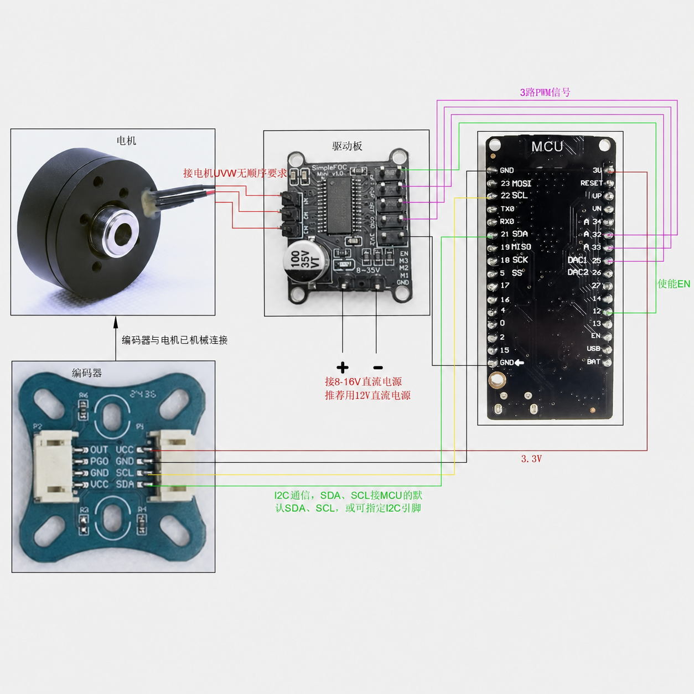
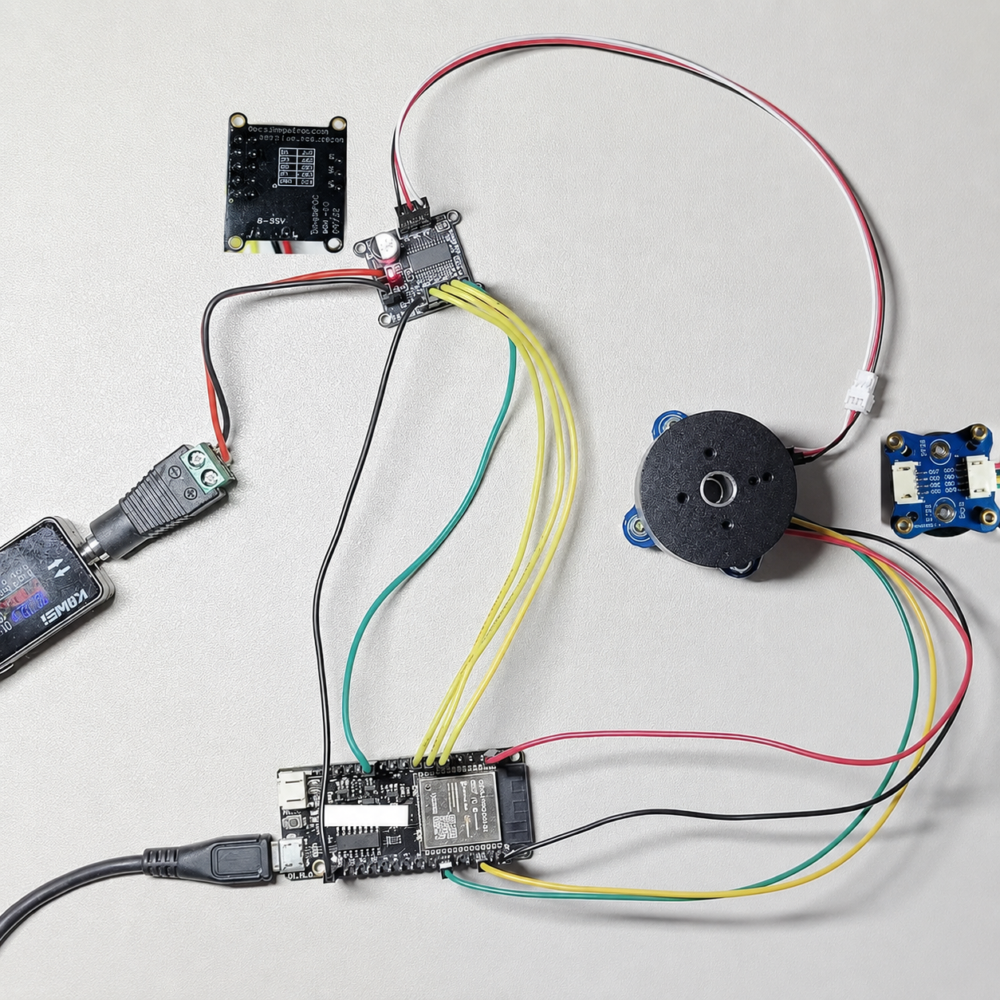

# ESP32 BLDC Motor Control with SimpleFOC

[中文说明](./README.zh-CN.md)

ESP32 and SimpleFOC firmware for a fixed-leg, two-wheel balancing robot, with motor bring-up examples and control-model simulations.

## Two-wheel balance firmware

`balance_car_new` drives two 2804 motors with MT6701 encoders and uses a Z-axis IMU pitch estimate. The right encoder uses SDA GPIO17 and SCL GPIO16. The left encoder and IMU share SDA GPIO21 and SCL GPIO22. The speed loop targets zero wheel speed and adjusts the pitch reference by up to ±1°. See the [balance firmware guide](./README_balance_new.md) and the [wiring table](./WIRING_I2C_new.md).

Support the chassis with both wheels off the ground before uploading or resetting. FOC alignment moves the wheels at startup. Close other serial monitors before opening the Viewer and replace `COM10` with the board's port.

```powershell
python -m pip install pyserial matplotlib
pio run -e balance_car_new -t upload
python tools/balance_viewer.py --port COM10
```

Use `CAL C` with the chassis upright, then verify the pitch and wheel directions. For a supported balance test, start with both wheels on the ground and stationary, then select `START A`. Use `STOP X` to stop the motors.

- `sensor_viewer` reads both encoders and the IMU with the drivers disabled. See the [sensor diagnostic guide](./SENSOR_VIEWER.md).
- `dual_motor_test_new` tests both motors independently of the IMU. See the [motor test guide](./README_new.md).
- See the [Viewer guide](./BALANCE_VIEWER_TUNING.md) for telemetry and tuning, or the [model and gain calculations](./analysis/revised_motor_pid/balance_defaults.md) for the current defaults. The firmware builds and host tests cover the control and fault paths. The new gains still need validation under load on the robot.

## Original AS5600 single-motor examples

The original examples cover sensor validation, open-loop motor testing, and closed-loop velocity control with one 2804 motor and a SimpleFOC Mini 3PWM driver.



## Project Highlights

- ESP32 motor-control bring-up with Arduino / PlatformIO
- AS5600 I2C magnetic encoder angle and velocity feedback
- SimpleFOC 3PWM BLDC driver integration
- Open-loop and closed-loop velocity control examples
- Serial command interface for target velocity and voltage-limit tuning
- Hardware wiring, BOM, and troubleshooting notes included for reproducibility

## Hardware

| Item | Description |
|---|---|
| MCU | DOIT ESP32 DevKit V1 / ESP32 Dev Module |
| Motor | 2804 BLDC gimbal motor, 7 pole pairs |
| Encoder | AS5600 I2C magnetic encoder module |
| Driver | SimpleFOC mini v1.0 3PWM BLDC driver board |
| Power Supply | 12V DC power supply, at least 2A recommended |



## Repository Structure

| Path | Purpose |
|---|---|
| `V1_01_AS5600_Sensor_Test/` | Validate AS5600 angle and velocity readings |
| `V1_02_2804_OpenLoop_Test/` | Test 2804 motor rotation without encoder feedback |
| `V1_03_ClosedLoop_Velocity_Test/` | Run closed-loop velocity control with AS5600 feedback |
| `platformio.ini` | Build environments for the motor examples, balance firmware, and diagnostics |
| `BOM.md` | Bill of materials |
| `DEPENDENCIES.md` | Arduino / ESP32 / SimpleFOC dependency notes |
| `TROUBLESHOOTING.md` | Common bring-up issues and checks |
| `docs/` | Wiring and setup images |

## Wiring

### AS5600 To ESP32

| AS5600 | ESP32 |
|---|---|
| VCC | 3.3V |
| GND | GND |
| SDA | GPIO21 |
| SCL | GPIO22 |

### SimpleFOC Mini To ESP32

| SimpleFOC mini | ESP32 |
|---|---|
| IN1 | GPIO32 |
| IN2 | GPIO33 |
| IN3 | GPIO25 |
| EN | GPIO12 |
| GND | GND |

### Power

- ESP32 is powered through USB.
- SimpleFOC mini is powered by an external 12V DC supply.
- ESP32 GND, SimpleFOC mini GND, and the power supply negative terminal must share a common ground.

## Safety Notes

- Keep the motor unloaded and firmly mounted during testing.
- Do not touch the motor shaft, phase wires, or driver board while the motor is running.
- Start with a low voltage limit and low target velocity.
- For the AS5600-only test, do not power the motor driver.
- Stop the test immediately if the motor or driver becomes hot.

## Test Workflow

1. Upload `V1_01_AS5600_Sensor_Test`.
2. Open Serial Monitor at `115200` baud.
3. Rotate the motor rotor by hand and verify that angle and velocity change.
4. Upload `V1_02_2804_OpenLoop_Test`.
5. Use serial commands to verify forward rotation, stop, and reverse rotation.
6. Upload `V1_03_ClosedLoop_Velocity_Test`.
7. Run `initFOC()` and verify closed-loop velocity control.

## Serial Commands

| Command | Meaning |
|---|---|
| `T3` | Slow forward rotation, mainly for closed-loop testing |
| `T6.28` | Forward rotation at about 1 rotation/s |
| `T0` | Stop |
| `T-6.28` | Reverse rotation at about 1 rotation/s |
| `L4` | Set motor voltage limit to 4V |
| `L5` | Set motor voltage limit to 5V |

## PlatformIO

The original single-motor examples use these PlatformIO environments.

| Environment | Sketch |
|---|---|
| `sensor_test` | `V1_01_AS5600_Sensor_Test` |
| `openloop_test` | `V1_02_2804_OpenLoop_Test` |
| `closedloop_velocity_test` | `V1_03_ClosedLoop_Velocity_Test` |

Build example:

```bash
pio run -e sensor_test
```

Upload example:

```bash
pio run -e closedloop_velocity_test -t upload
```

Serial monitor:

```bash
pio device monitor -b 115200
```

## Verified Results

- AS5600 angle and velocity readings work correctly.
- Open-loop forward rotation, stop, and reverse rotation work correctly.
- Closed-loop velocity control forward rotation, stop, and reverse rotation work correctly.
- Closed-loop `initFOC()` completed with sensor alignment and pole-pair check OK.
- Current sensing is not used in this setup; the `No current sense` message in the log is expected.

## Demo And Logs

- [Motor demo video](./docs/demo.mp4)
- [Closed-loop serial log](./docs/closedloop-serial-log.txt)

## Documentation

- [BOM](./BOM.md)
- [Dependencies](./DEPENDENCIES.md)
- [Troubleshooting](./TROUBLESHOOTING.md)

## License

This project is released under the [MIT License](./LICENSE).
