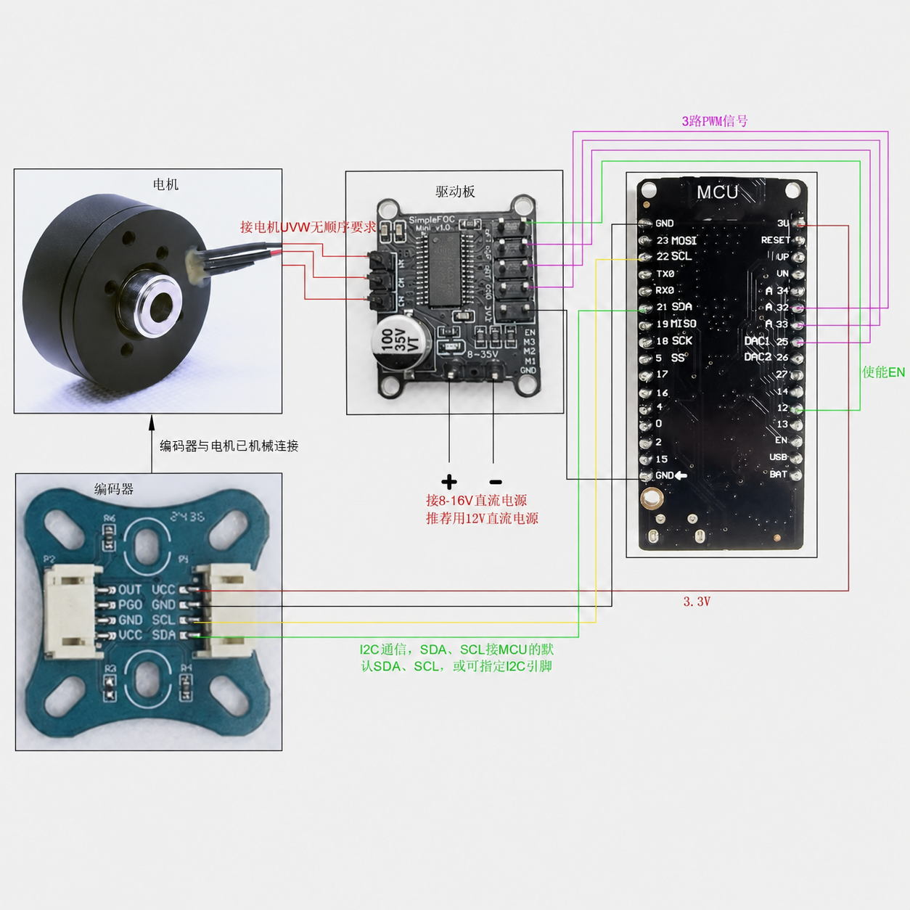
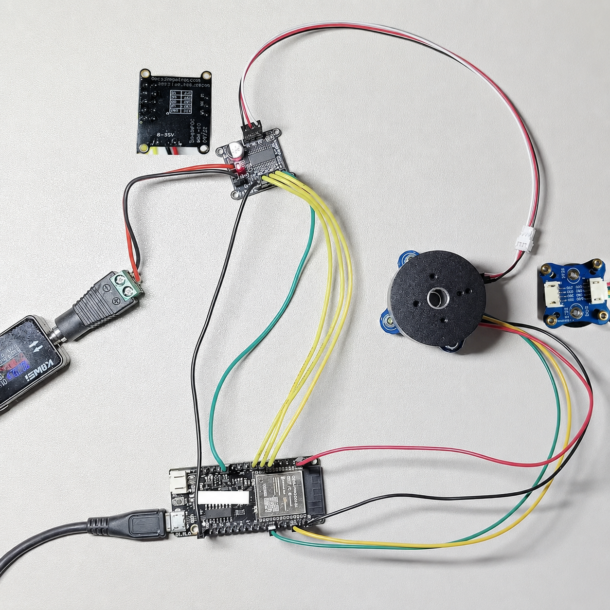

# ESP32 BLDC Motor Control with SimpleFOC

[English](./README.md)

本仓库包含基于 ESP32 和 SimpleFOC 的固定腿双轮平衡车固件，以及单电机调试示例和控制仿真。

## 双轮平衡车固件

`balance_car_new` 使用两台 2804 电机、两个 MT6701 编码器和一块 IMU。右编码器接 SDA GPIO17、SCL GPIO16，左编码器和 IMU 共用 SDA GPIO21、SCL GPIO22。当前使用 IMU 的 Z 轴测量俯仰，速度外环默认以零速为目标，倾角修正限幅 ±1°。详见[平衡固件指南](./README_balance_new.md)和[接线表](./WIRING_I2C_new.md)。

烧录或复位前，先支撑车身并架空两轮。启动时 FOC 对齐会转动车轮。关闭其他串口监视器，再打开 Viewer。将 `COM10` 替换为开发板的实际端口。

```powershell
python -m pip install pyserial matplotlib
pio run -e balance_car_new -t upload
python tools/balance_viewer.py --port COM10
```

将车身扶正后用 `CAL C` 校准，检查俯仰和两轮方向。首次扶持平衡测试时，先让两轮接地并停稳，再点 `START A`。用 `STOP X` 停机。

- `sensor_viewer` 在驱动禁用时读取两个编码器和 IMU。见[传感器诊断指南](./SENSOR_VIEWER.md)。
- `dual_motor_test_new` 独立于 IMU 测试双轮。见[电机测试指南](./README_new.md)。
- [Viewer 调参指南](./BALANCE_VIEWER_TUNING.md)记录遥测和调参操作，[模型与增益复算](./analysis/revised_motor_pid/balance_defaults.md)记录当前默认参数。固件编译和主机测试已覆盖控制及故障处理流程，当前增益的实车负载表现仍待验证。

## 早期 AS5600 单电机示例

原有示例采用一台 2804 电机和 SimpleFOC Mini 3PWM 驱动，覆盖接线、传感器验证、开环和闭环速度测试。



## 项目亮点

- 使用 ESP32 完成 BLDC 电机控制系统搭建
- 基于 SimpleFOC 实现开环和闭环速度控制
- 使用 AS5600 I2C 磁编码器读取转子角度和速度反馈
- 使用 SimpleFOC mini v1.0 作为 3PWM 无刷电机驱动板
- 支持串口命令调节目标速度和电压限制
- 包含 BOM、依赖说明、排错文档、实物图、运行视频和串口日志
- 项目重点覆盖嵌入式开发、电机控制和硬件调试能力

## 硬件配置

| 项目 | 说明 |
|---|---|
| 主控 | DOIT ESP32 DevKit V1 / ESP32 Dev Module |
| 电机 | 2804 BLDC gimbal motor, 7 pole pairs |
| 编码器 | AS5600 I2C magnetic encoder module |
| 驱动板 | SimpleFOC mini v1.0 3PWM BLDC driver board |
| 电源 | 12V DC power supply, at least 2A recommended |



## 仓库结构

| 路径 | 说明 |
|---|---|
| `V1_01_AS5600_Sensor_Test/` | AS5600 角度和速度读取测试 |
| `V1_02_2804_OpenLoop_Test/` | 2804 电机开环控制测试 |
| `V1_03_ClosedLoop_Velocity_Test/` | 基于 AS5600 反馈的闭环速度控制测试 |
| `platformio.ini` | 单电机示例、平衡固件和诊断环境配置 |
| `BOM.md` | 物料清单 |
| `DEPENDENCIES.md` | Arduino / ESP32 / SimpleFOC 依赖说明 |
| `TROUBLESHOOTING.md` | 常见硬件调试问题排查 |
| `docs/` | 接线图、实物图、视频和串口日志 |

## 接线说明

### AS5600 连接 ESP32

| AS5600 | ESP32 |
|---|---|
| VCC | 3.3V |
| GND | GND |
| SDA | GPIO21 |
| SCL | GPIO22 |

### SimpleFOC mini 连接 ESP32

| SimpleFOC mini | ESP32 |
|---|---|
| IN1 | GPIO32 |
| IN2 | GPIO33 |
| IN3 | GPIO25 |
| EN | GPIO12 |
| GND | GND |

### 供电说明

- ESP32 通过 USB 供电。
- SimpleFOC mini 使用外部 12V DC 电源供电。
- ESP32 GND、SimpleFOC mini GND 和 12V 电源负极必须共地。

## 安全注意事项

- 测试时请确保电机固定牢靠，并尽量空载运行。
- 电机运行时不要触碰电机轴、相线和驱动板。
- 调试时先使用较低的电压限制和较低的目标速度。
- 仅测试 AS5600 传感器时，不要给电机驱动板上电。
- 如果电机或驱动板明显发热，应立即停止测试。

## 测试流程

1. 上传 `V1_01_AS5600_Sensor_Test`。
2. 打开串口监视器，波特率设置为 `115200`。
3. 手动旋转电机转子，确认角度和速度数据会变化。
4. 上传 `V1_02_2804_OpenLoop_Test`。
5. 使用串口命令测试电机正转、停止和反转。
6. 上传 `V1_03_ClosedLoop_Velocity_Test`。
7. 等待 `initFOC()` 完成，测试闭环速度控制。

## 串口命令

| 命令 | 说明 |
|---|---|
| `T3` | 慢速闭环正转测试 |
| `T6.28` | 正转，约 1 转/秒 |
| `T0` | 停止 |
| `T-6.28` | 反转，约 1 转/秒 |
| `L4` | 设置电压限制为 4V |
| `L5` | 设置电压限制为 5V |

## PlatformIO 使用

原有单电机示例使用以下 PlatformIO 环境。

| 环境 | 对应示例 |
|---|---|
| `sensor_test` | `V1_01_AS5600_Sensor_Test` |
| `openloop_test` | `V1_02_2804_OpenLoop_Test` |
| `closedloop_velocity_test` | `V1_03_ClosedLoop_Velocity_Test` |

编译示例：

```bash
pio run -e sensor_test
```

上传示例：

```bash
pio run -e closedloop_velocity_test -t upload
```

串口监视器：

```bash
pio device monitor -b 115200
```

## 已验证结果

- AS5600 可以正确读取角度和角速度。
- 2804 电机开环正转、停止、反转测试通过。
- 基于 AS5600 的闭环速度控制测试通过。
- `initFOC()` 完成传感器对齐，极对数检查结果为 OK。
- 本项目未使用电流采样，日志中的 `No current sense` 信息属于预期现象。

## 演示与日志

- [电机运行视频](./docs/demo.mp4)
- [闭环控制串口日志](./docs/closedloop-serial-log.txt)

## 面向简历的项目描述

基于 ESP32、SimpleFOC mini v1.0、AS5600 磁编码器和 2804 无刷云台电机，完成 BLDC 电机控制系统的搭建与调试。项目包含传感器读取、开环速度控制、闭环速度控制、串口命令调参、硬件接线验证和故障排查文档，重点体现嵌入式开发、电机控制和硬件调试能力。

## 相关文档

- [物料清单](./BOM.md)
- [依赖说明](./DEPENDENCIES.md)
- [问题排查](./TROUBLESHOOTING.md)

## 开源协议

本项目基于 [MIT License](./LICENSE) 开源。
